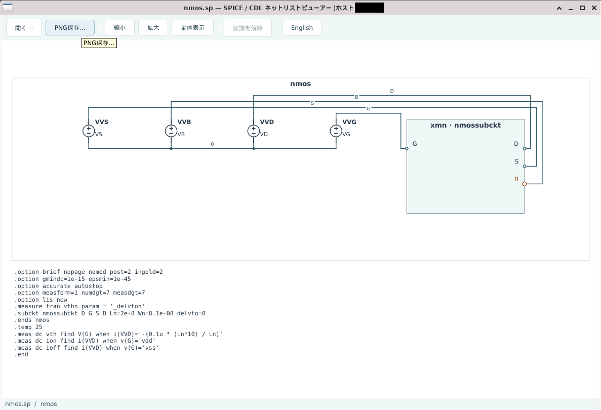
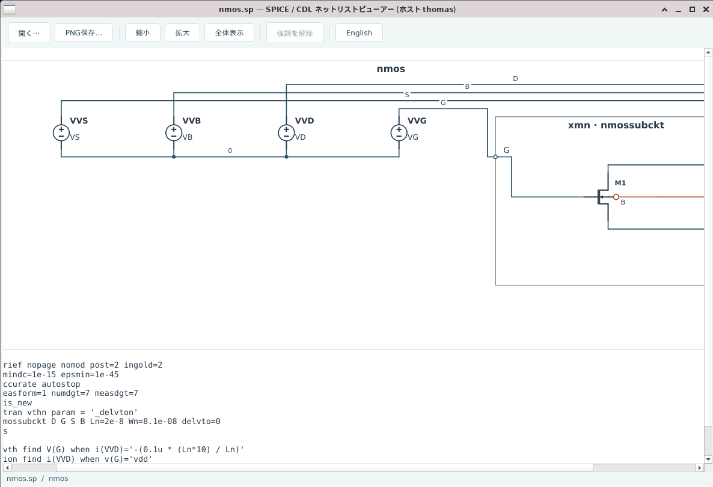
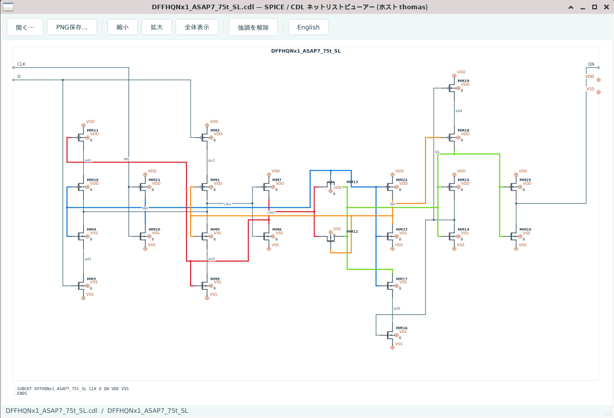

# SPICE／CDLネットリストビューアー

PythonでSPICE／CDLネットリストを読み込み、回路図をデスクトップウィンドウに表示します。サブ回路とバスを開閉し、表示中の回路図全体をPNGとして保存できます。

## 起動

Python 3.10以降とPySide6が必要です。ZIPを展開し、READMEがあるフォルダに移動して実行します。Linux のみ動作確認しています。

**Windows（PowerShell）**

```powershell
py -m venv .venv
.\.venv\Scripts\python.exe -m pip install -r requirements.txt
.\.venv\Scripts\python.exe -m spiceviewer spice.cdl
```

**macOS／Linux**

```sh
python3 -m venv .venv
.venv/bin/python -m pip install -r requirements.txt
.venv/bin/python -m spiceviewer spice.cdl
```

## What can do
- Expand/collapse subcircuit. (click subcircuit)
- Highlight wires. (click wire)
- Show/hide power ground lines (click port)

## sanokes



